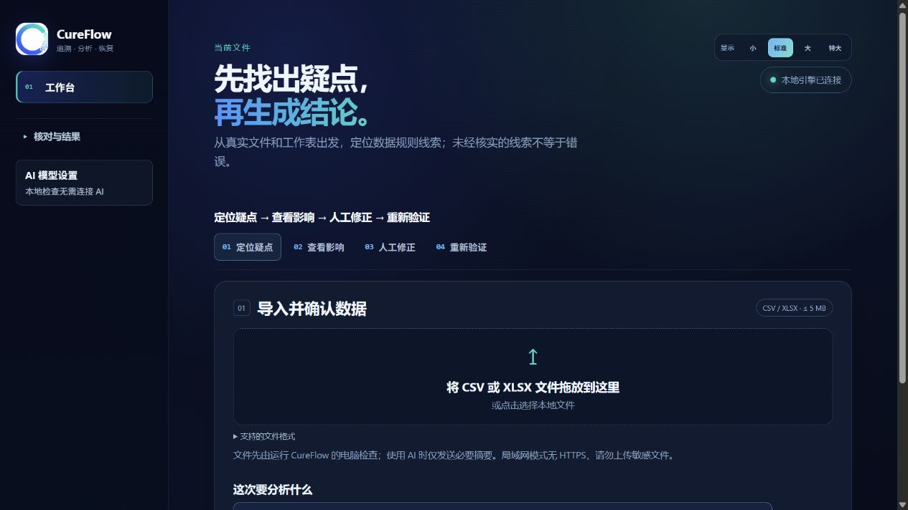
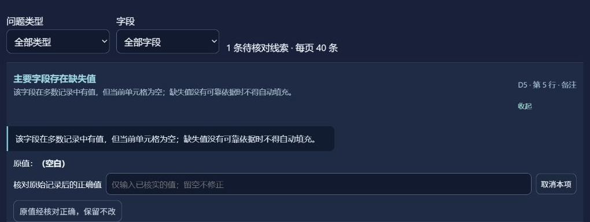

# CureFlow

**找出数据分析中的疑点，核对影响，修正后再验证。**

CureFlow 是一个本地优先的 Windows 桌面项目。它让你导入自己的 CSV/XLSX，确认读取内容，查看具体问题线索，在原始记录的依据下进行人工复核，再生成修正版副本并复测。需要解释结果或写报告时，可以按需接入自己有权使用的 AI 模型；**本地检查不需要 API Key**。

> **当前公开状态：这里发布的是源码，不是可直接下载的最新 Windows 安装包。** 本机曾制作过旧版验证包，但它没有随仓库上传，也不代表当前界面。想体验当前版本，请按下方步骤从源码运行；面向普通用户的安装包需要重新构建并在干净的 Windows 机器上验收后发布。



*截图来自实际运行的程序，使用自建测试表格；不包含真实用户数据。界面可能随版本更新。*

## 使用流程

1. **导入并确认数据**：选择或拖入不超过 5 MB 的 CSV/XLSX，核对工作表、行列数和字段。
2. **查看疑点及依据**：运行本地检查，查看具体的工作表、行、列、原值和规则说明。统计极端值只是复核线索，不能直接判定为错误。
3. **人工复核**：对照原始记录，保留正确值，或填入已经核实的值。系统不会猜测缺失值，也不会覆盖原文件。
4. **生成副本并复测**：只对已确认的改动生成修正版，并重新检查受影响结果。AI 解读和报告是可选步骤，不阻塞本地检查。

<details>
<summary>查看人工复核界面的实际截图</summary>



*该截图使用自建测试表格。显示的是待核对线索，不是已确认的数据错误。*

</details>

## 从源码启动当前桌面版

开发者需要 **Windows、Python 3.10+、Node.js 20.19+ 或 22.12+**。在克隆的仓库根目录运行：

```powershell
python -m pip install -r requirements.txt
cd desktop
npm ci
npm start
```

启动后 Electron 会打开桌面窗口，并自动启动本地分析服务。普通用户安装未来通过验收的正式安装包时，不应需要这些开发工具；但**本仓库目前没有提供可直接下载的当前版安装包**。更完整的安装、模型连接及隐私说明见 [桌面版使用说明](desktop/README.md)。

## 功能与边界

| 项目 | 当前情况 |
|---|---|
| 支持文件 | CSV、XLSX，单文件不超过 5 MB；XLSX 读取可见且非空的工作表，每表最多 10,000 行数据、100 列 |
| 本地分析 | 文件结构、质量及满足条件的统计分析；方法由字段类型、样本和分析目标决定，不对所有数值列一律做 IQR |
| 人工修正 | 保留原文件；仅对已核实的修改生成副本并复测 |
| 可选 AI | OpenAI、Qwen、DeepSeek、豆包；由使用者提供有效密钥、权限并明确授权调用，不保证第三方服务始终可用 |
| 数据边界 | 本机文件分析不调用云模型；选择云端解读后，会向所选服务发送必要的字段摘要、统计值和证据上下文，这些信息也可能敏感 |

项目目标还包括追踪分析产物的来源和依赖、定位错误对下游结果的影响，以及复用未受影响的步骤。桌面端当前功能与底层研究工作流的能力应分别看待，不能把恢复计划当成已经完成的复测。局域网访问目前没有 HTTPS、多用户隔离或正式账号体系，**不要公开暴露到互联网，也不要直接处理未经授权的敏感数据**。

## 验证与项目导航

- [桌面版使用、隐私和故障排查](desktop/README.md)
- [最近一次源码核对记录](docs/RELEASE_CHECK_20261001.md)：记录了当时环境中的测试结果及尚未完成的安装包验收；不是对未来提交的自动保证。
- 核心代码：[桌面前端](desktop/)、[本地服务](cureflow_app/)、[溯源与恢复](provenance/)、[自动化测试](tests/)

公开源码不包含历史冻结实验的原始证据、本机密钥或个人申报材料。因此，历史证据核验只能在持有完整档案的环境运行；不能把公开仓库中缺少的证据描述成已复核。当前版本也尚无受信任的 Windows 代码签名和干净机器安装验收。

<details>
<summary>展开技术设计与历史研究记录</summary>

以下内容说明底层研究工作流和历史阶段结果，不等同于当前桌面版所有功能均已完成产品验收。

---

## 1. 三件核心能力

| 能力 | 描述 | 实现位置 |
|---|---|---|
| **Semantic Artifact Provenance** | 每个 artifact 携带完整 provenance：谁产出、依赖谁、引用了哪些证据 | `provenance/decorator.py` + `provenance/graph.py` |
| **Contamination Tracking** | 错误沿数据流 / 引用边传播，BFS + dedup + 终止条件 | `contamination/propagation.py` + `contamination/validator.py` |
| **Dependency-aware Selective Recovery** | 基于污染图选 SELECTIVE/COARSE/FULL 三种恢复策略 | `recovery/strategy.py` + `recovery/strategies/*.py` + `recovery/executor.py` |
| **Claim Grounding Audit** | 逐条核对数字、证据身份、引用生命周期、因果外推与范围扩张；明确区分本次观测风险率和总体幻觉率 | `validation/claim_grounding.py` + [`CLAIM_GROUNDING.md`](CLAIM_GROUNDING.md) |

---

## 2. 历史研究工作流：v2 算法升级

相比 v1 baseline，v2 在三个层面做了数据驱动改造：

| 子方向 | v1 | v2 | 价值 |
|---|---|---|---|
| **5 阶段调度** | 硬编码 if/elif | 数据驱动 `Stage` table + `Scheduler` | 加 1 阶段 = 1 行 table + 1 函数，0 行改 runner |
| **恢复策略** | 3 策略硬编码 | `Strategy` Protocol + `@register_strategy` registry | 加 1 策略 = 1 class + 1 decorator，0 行改 planner |
| **Artifact 缓存** | 无淘汰 KV | `SemanticLRUCache` (4 规则：LRU 兜底 + 中心性加权 + 失败拒绝 + size cap) | opt-in，默认 off（向后兼容） |

**v2 阶段记录**：当时新增 96 项测试（33 scheduler + 34 strategy + 29 cache），该阶段曾记录 731/731 通过。这是历史结果，不是当前工作区的全量测试结论；发布前须重新运行测试。

---

## 3. 5 阶段数据流

```
extract → metrics → claims → sections → merge
  │         │         │          │         │
  ▼         ▼         ▼          ▼         ▼
raw_data  fields   metrics    claims   report_merged
                    claims
```

每个 stage 是 `Stage(name=, inputs=, outputs=, execute=, validators=, retries=, on_failure=)` 声明式定义。

---

## 4. 三种恢复策略（v2 策略市场）

| 策略 | 行为 | 适用 |
|---|---|---|
| **SELECTIVE_RECOVERY** | 只重算污染图中的影响节点，其他复用 | 错误范围小，< 30% 节点受影响 |
| **COARSE_CHECKPOINT** | 重算 metrics/claims 之后，fields 复用 | 中等范围，30-70% 节点 |
| **FULL_RERUN** | 全部重算，0 复用 | 错误范围广，> 70% 节点 |

注册新策略：

```python
from recovery import register_strategy, REGISTRY

@register_strategy("MY_STRATEGY")
class MyStrategy:
    name = "MY_STRATEGY"
    def applicable(self, cr): ...
    def plan(self, cr, ctx): ...
    def dispatch_step(self, step, ctx): ...
```

加完即被 `RecoveryExecutor.execute()` 自动 dispatch。

---

## 5. 实验数字与产品边界

### 5.1 区分离线实验与真实模型
- 历史确定性实验可使用 `default_workflow_llm()` 的离线 fixture；这不是普通用户在桌面产品里选择的云模型。
- 桌面产品可按需连接 OpenAI、Qwen、DeepSeek、豆包；本地文件检查不依赖云模型。密钥由使用者提供并明确授权调用，不随安装包分发。
- fixture 的 token / calls 数字不代表第三方服务性能，也不能当作产品成本或成功率承诺。真实 Provider 的实验数字只适用于对应实验条件。

### 5.2 5-axis 指标（Stage 1.5 frozen）
| axis | 含义 |
|---|---|
| `provider_success` | LLM 返回可解析响应 |
| `recovery_execution_success` | 重试/恢复执行成功 |
| `output_contract_valid` | 输出匹配 schema |
| `semantic_validation_success` | 语义验证通过 |
| `trial_valid` | 4 个 axis 都 True |

**不可改**。M1（Qwen 60 trial）/ M3（DeepSeek 60 trial）evidence 锁在 `experiments/results/exp02/`。

### 5.3 当前验证方式
- 在当前源码和环境中运行 `python -m pytest tests/ -q`；不要把旧交接文档中的 609、731 或 960 项通过数当作当前验收结果。
- 历史冻结证据保留在原实验机器，不随源码上传。持有完整证据时运行 `python scripts/verify_evidence_sha.py`；没有证据不能声称已完成历史实验核验。后续改动仍须重新核验。
- 发布桌面版前还须运行 `cd desktop` 后的 `npm run smoke-test`，并在干净 Windows 机器上验安装、启动、文件导入和卸载。

---

## 6. 怎么跑

### 6.1 开发者安装依赖

需要 Python 3.10+，以及 Node.js 20.19+ 或 22.12+。使用仓库的 `package-lock.json` 安装桌面依赖，避免每台机器自行选取不同依赖版本。
```powershell
# 在源码根目录执行
pip install -r requirements.txt
```

### 6.2 跑测试
```powershell
python -m pytest tests/ -q
# 以下核验需要原实验机器上的冻结证据，公开源码不包含这些文件
python scripts/verify_evidence_sha.py
```

### 6.3 从源码启动桌面版
```powershell
cd desktop
npm ci
npm start
# 构建界面、启动 Electron，并自动启动本地服务
```

桌面端支持上传不超过 5 MB 的 `.csv` 或 `.xlsx`。XLSX 会读取全部可见且非空的工作表，每表最多 10000 行数据和 100 列。单表会自动识别中英文经营字段；其他矩形数值数据进入本地通用表格画像。多工作表文件会进入关系分析，区分训练集与实验集，列出共有字段、仅单表字段，并把“训练集有值而实验集为空”的列标为结构上的候选目标列。该判断只描述数据结构，不代替题目对业务含义或预测目标的定义。

详见 `desktop/README.md`。

### 6.4 跑 v2 性能 baseline
```powershell
# 项目根
python _v2_perf_baseline.py
# 输出 _v2_perf_report_data.json + _v2_perf_report.md
```

---

## 7. 目录结构

```
poc/
├── artifacts/         # Artifact schema + JSON file store + (v2) SemanticLRUCache
├── contamination/     # 错误传播 + 验证
├── llm/               # LLMClient 抽象 + FakeLLMClient + parse
├── provenance/        # 装饰器追踪 + ArtifactGraph
├── recovery/          # 策略市场 + executor
├── validation/        # 语义验证（numeric / direction / boundary）
├── workflow/          # 5 阶段数据驱动调度
│   ├── scheduler.py   # v2 Stage + Scheduler
│   ├── stages.py      # v2 BASELINE_TABLE
│   └── runner.py      # 向后兼容 run_baseline_workflow
├── cureflow_app/      # Desktop backend (HTTP API)
├── desktop/           # Electron + Vite + React 前端
├── tests/             # 自动化测试；数量以本次 pytest 结果为准
└── experiments/       # 实验代码；results/ 中冻结证据仅保留在本机
```

---

## 8. 当前限制

- 已有 Windows 安装包验证版，但尚需在另一台干净 Windows 机器完成安装、卸载及 XLSX 验收；当前没有受信任的代码签名，不应宣称已可大规模公开分发。
- 可接入真实第三方 Provider，但调用是否可用取决于使用者的有效密钥、模型权限、网络和明确授权；不保证所有模型始终可用。
- 局域网链接只适合可信网络试用；当前缺少 HTTPS、多用户隔离和正式账号体系，不应公开到互联网或用于敏感数据。
- AI 解读和统计线索不能代替原始记录核查与领域专家判断；当前选择性恢复计划与实际已执行的复测结果必须区分。
- 语言界面目前主要面向中文用户；尚未提供完整国际化。

历史 M3 实验报告与原始证据仅保留在实验机器，不随公开源码上传；其条件和数字不能外推为当前桌面版的整体表现。

---

## 9. 怎么贡献 / 扩展

- **加 1 阶段**：`workflow/stages.py` 写 1 函数 + `BASELINE_TABLE.append(Stage(...))`
- **加 1 策略**：`recovery/strategies/my_strategy.py` 写 1 class + `@register_strategy("MY")`
- **加 1 缓存规则**：`artifacts/cache.py` 继承 `EvictionPolicy` 写 1 class
- **加 1 fault type**：`contamination/propagation.py` 写 1 propagation 函数

每个改动应有相应测试，并以当前源码运行的全量测试、证据校验和桌面验收结果为准，不沿用历史通过数量。

</details>
