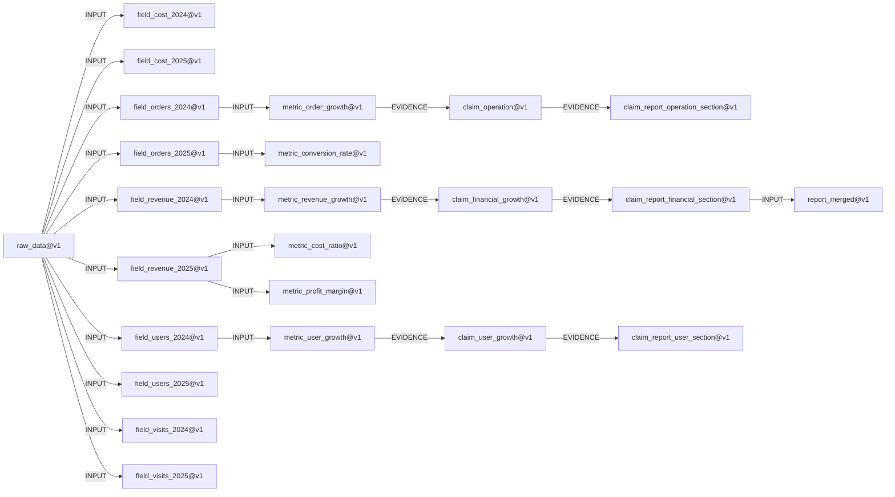

# CureFlow 可解释影响报告

- 运行编号：`impact_report_sample`
- 节点总数：24
- 受影响节点：24（100.00%）
- 可复用节点：0

## 节点列表

| 节点 | 状态 |
|---|---|
| `claim_financial_growth@v1` | CONTAMINATED |
| `claim_operation@v1` | CONTAMINATED |
| `claim_report_financial_section@v1` | CONTAMINATED |
| `claim_report_operation_section@v1` | CONTAMINATED |
| `claim_report_user_section@v1` | CONTAMINATED |
| `claim_user_growth@v1` | CONTAMINATED |
| `field_cost_2024@v1` | CONTAMINATED |
| `field_cost_2025@v1` | CONTAMINATED |
| `field_orders_2024@v1` | CONTAMINATED |
| `field_orders_2025@v1` | CONTAMINATED |
| `field_revenue_2024@v1` | CONTAMINATED |
| `field_revenue_2025@v1` | CONTAMINATED |
| `field_users_2024@v1` | CONTAMINATED |
| `field_users_2025@v1` | CONTAMINATED |
| `field_visits_2024@v1` | CONTAMINATED |
| `field_visits_2025@v1` | CONTAMINATED |
| `metric_conversion_rate@v1` | CONTAMINATED |
| `metric_cost_ratio@v1` | CONTAMINATED |
| `metric_order_growth@v1` | CONTAMINATED |
| `metric_profit_margin@v1` | CONTAMINATED |
| `metric_revenue_growth@v1` | CONTAMINATED |
| `metric_user_growth@v1` | CONTAMINATED |
| `raw_data@v1` | INVALIDATED |
| `report_merged@v1` | CONTAMINATED |

## 边列表

| 上游 | 下游 | 类型 |
|---|---|---|
| `claim_financial_growth@v1` | `claim_report_financial_section@v1` | EVIDENCE |
| `claim_financial_growth@v1` | `claim_report_financial_section@v1` | INPUT |
| `claim_operation@v1` | `claim_report_operation_section@v1` | EVIDENCE |
| `claim_operation@v1` | `claim_report_operation_section@v1` | INPUT |
| `claim_report_financial_section@v1` | `report_merged@v1` | INPUT |
| `claim_report_operation_section@v1` | `report_merged@v1` | INPUT |
| `claim_report_user_section@v1` | `report_merged@v1` | INPUT |
| `claim_user_growth@v1` | `claim_report_user_section@v1` | EVIDENCE |
| `claim_user_growth@v1` | `claim_report_user_section@v1` | INPUT |
| `field_cost_2025@v1` | `metric_cost_ratio@v1` | INPUT |
| `field_cost_2025@v1` | `metric_profit_margin@v1` | INPUT |
| `field_orders_2024@v1` | `metric_order_growth@v1` | INPUT |
| `field_orders_2025@v1` | `metric_conversion_rate@v1` | INPUT |
| `field_orders_2025@v1` | `metric_order_growth@v1` | INPUT |
| `field_revenue_2024@v1` | `metric_revenue_growth@v1` | INPUT |
| `field_revenue_2025@v1` | `metric_cost_ratio@v1` | INPUT |
| `field_revenue_2025@v1` | `metric_profit_margin@v1` | INPUT |
| `field_revenue_2025@v1` | `metric_revenue_growth@v1` | INPUT |
| `field_users_2024@v1` | `metric_user_growth@v1` | INPUT |
| `field_users_2025@v1` | `metric_user_growth@v1` | INPUT |
| `field_visits_2025@v1` | `metric_conversion_rate@v1` | INPUT |
| `metric_conversion_rate@v1` | `claim_operation@v1` | EVIDENCE |
| `metric_conversion_rate@v1` | `claim_operation@v1` | INPUT |
| `metric_cost_ratio@v1` | `claim_financial_growth@v1` | INPUT |
| `metric_order_growth@v1` | `claim_operation@v1` | EVIDENCE |
| `metric_order_growth@v1` | `claim_operation@v1` | INPUT |
| `metric_profit_margin@v1` | `claim_financial_growth@v1` | EVIDENCE |
| `metric_profit_margin@v1` | `claim_financial_growth@v1` | INPUT |
| `metric_revenue_growth@v1` | `claim_financial_growth@v1` | EVIDENCE |
| `metric_revenue_growth@v1` | `claim_financial_growth@v1` | INPUT |
| `metric_user_growth@v1` | `claim_user_growth@v1` | EVIDENCE |
| `metric_user_growth@v1` | `claim_user_growth@v1` | INPUT |
| `raw_data@v1` | `field_cost_2024@v1` | INPUT |
| `raw_data@v1` | `field_cost_2025@v1` | INPUT |
| `raw_data@v1` | `field_orders_2024@v1` | INPUT |
| `raw_data@v1` | `field_orders_2025@v1` | INPUT |
| `raw_data@v1` | `field_revenue_2024@v1` | INPUT |
| `raw_data@v1` | `field_revenue_2025@v1` | INPUT |
| `raw_data@v1` | `field_users_2024@v1` | INPUT |
| `raw_data@v1` | `field_users_2025@v1` | INPUT |
| `raw_data@v1` | `field_visits_2024@v1` | INPUT |
| `raw_data@v1` | `field_visits_2025@v1` | INPUT |

## 传播路径

- `raw_data@v1` → `field_cost_2024@v1`
- `raw_data@v1` → `field_cost_2025@v1`
- `raw_data@v1` → `field_orders_2024@v1` → `metric_order_growth@v1` → `claim_operation@v1` → `claim_report_operation_section@v1`
- `raw_data@v1` → `field_orders_2025@v1` → `metric_conversion_rate@v1`
- `raw_data@v1` → `field_revenue_2024@v1` → `metric_revenue_growth@v1` → `claim_financial_growth@v1` → `claim_report_financial_section@v1` → `report_merged@v1`
- `raw_data@v1` → `field_revenue_2025@v1` → `metric_cost_ratio@v1`
- `raw_data@v1` → `field_revenue_2025@v1` → `metric_profit_margin@v1`
- `raw_data@v1` → `field_users_2024@v1` → `metric_user_growth@v1` → `claim_user_growth@v1` → `claim_report_user_section@v1`
- `raw_data@v1` → `field_users_2025@v1`
- `raw_data@v1` → `field_visits_2024@v1`
- `raw_data@v1` → `field_visits_2025@v1`

## 路径图

## 复用建议

当前没有可直接复用的节点，建议扩大恢复范围。
